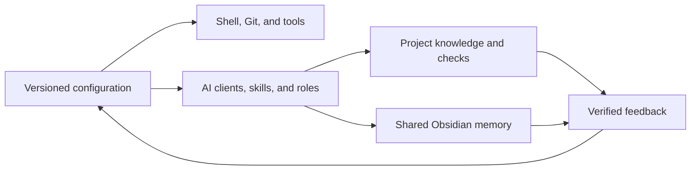

# Dotfiles

A versioned development workstation with shell, Git, tools, and AI coding agents configured together.
Built for Apple Silicon macOS, with partial Debian support.

**This is a personal setup reference for Lluvia and my close ones, not a universal installer.**

## Before installing

Read [setup](/docs/setup.md) before installing or configuring local overrides.

**Installation risks:** Review SSH/AWS defaults before adopting this setup.
Installation changes home-directory files and the login shell.
Full sync can remove packages and push skill-lockfile commits; read setup boundaries before running
commands.

## What this configures

- **Shell:** Zsh completion, aliases, terminal settings, and a welcome prompt.
- **Tools:** Homebrew manages applications and system tools; Mise manages development tools.
- **Coding agents:** Pi, Claude Code, and Cursor share maintained configuration and agent guidance.
- **Local settings:** Git identity, signing, and shell overrides keep personal values outside Git.

The environment connects workstation configuration, AI clients, project knowledge, and shared memory:

**Principles:** Communicate assertively and prioritize maintainability.
Keep code, documentation, and the working environment understandable, verifiable, and easy to change.

Read [architecture](/docs/architecture.md) before changing these connections.
Read [the glossary](/GLOSSARY.md) before changing shared terminology.

## Use and maintain the environment

Choose the guide for your task; read [agent instructions](/AGENTS.md) before changing this repository.

| Before you… | Read |
| --- | --- |
| Maintain packages, run checks, or synchronize the workstation | [Tooling](/docs/tooling.md) |
| Configure Pi, Claude Code, or Cursor | [Coding agents](/docs/coding-agents/README.md) |
| Use subscription voice or Pi-specific integrations | [Pi and live voice](/docs/coding-agents/pi/README.md) |
| Provision the shared vault's tools and checks | [Obsidian](/docs/obsidian.md) |
| Change shell startup | [Zsh configuration](/docs/zsh-configuration.md) |
| Change Git defaults, identity, or signing | [Git configuration](/docs/git-configuration.md) |
| Change installation or update behavior | [Scripts](/scripts/README.md) |
| Use editable UI designs | [Design tooling](/docs/agent-ui-design-tools.md) |
| Restructure or retire maintained information | [Documentation maintenance](/docs/documentation.md) |

Plans and evidence live in [the agent workspace](/.agents/README.md).
They explain prior work; **current guides and verified configuration own present behavior**.
