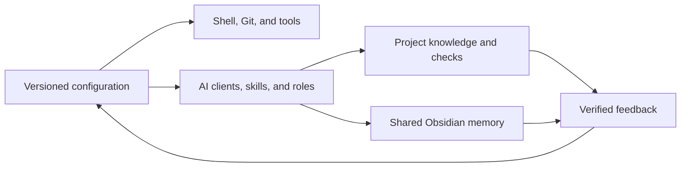

# Dotfiles

**Purpose:** A versioned development workstation with shell, Git, tools, and AI coding agents
configured together.
Built for Apple Silicon macOS, with partial Debian support.
This is a personal setup reference for Lluvia and my close ones, not a universal installer.

## Understand the environment

**Principles:** Communicate assertively and care about maintainability.
Keep code, documentation, and the working environment understandable, verifiable, and easy to
change.

Read [the architecture](/docs/architecture.md) before changing how configuration, agents, and shared
memory connect.
Read [the glossary](/GLOSSARY.md) before changing the environment's shared terminology.

## Set up and use

- Read [setup](/docs/setup.md) before installing or configuring local overrides.
- Read [tooling](/docs/tooling.md) before maintaining packages, running checks, or synchronizing the
  workstation.
- Read [coding agents](/docs/coding-agents/README.md) before configuring Pi, Claude Code, or Cursor.
- Read [Pi and live voice](/docs/coding-agents/pi/README.md) before using subscription voice or
  Pi-specific integrations.
- Read [Obsidian](/docs/obsidian.md) before provisioning the shared vault's tools and checks.

**Included:** Zsh completion, aliases, terminal settings, and a welcome prompt.
Homebrew owns applications and system tools; Mise owns development tools.
Local Git identity, signing, and shell overrides keep personal values outside Git.

**Installation risks:** Review SSH/AWS defaults before adopting this setup.
Installation changes home-directory files and the login shell.
Full sync can remove packages and push skill-lockfile commits; read setup boundaries before running
commands.

## Maintain and evolve

- Read [agent instructions](/AGENTS.md) before changing this repository.
- Read [documentation maintenance](/docs/documentation.md) before restructuring or retiring
  maintained information.
- Read [Zsh configuration](/docs/zsh-configuration.md) before changing shell startup behavior.
- Read [Git configuration](/docs/git-configuration.md) before changing defaults, identity, or
  signing.
- Read [scripts](/scripts/README.md) before changing installation and update behavior.
- Read [design tooling](/docs/agent-ui-design-tools.md) before using editable UI designs.

**History:** Plans and evidence live in [the agent workspace](/.agents/README.md).
They explain prior work; current guides and verified configuration own present behavior.
