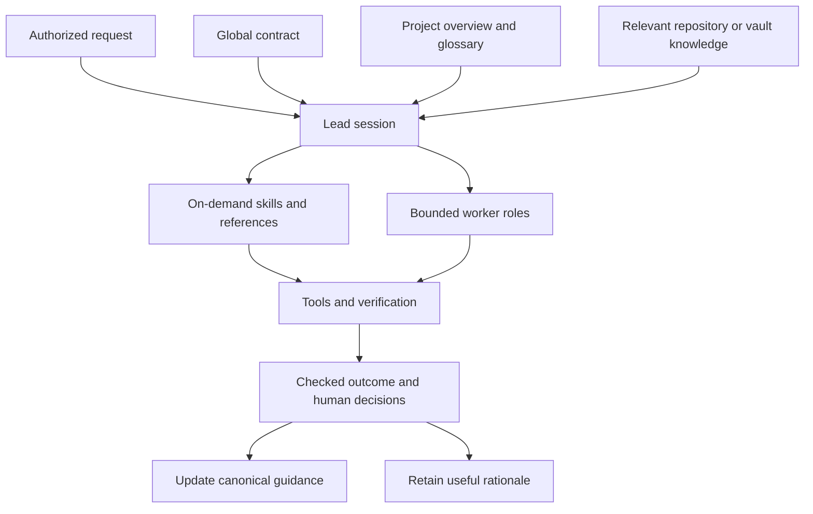
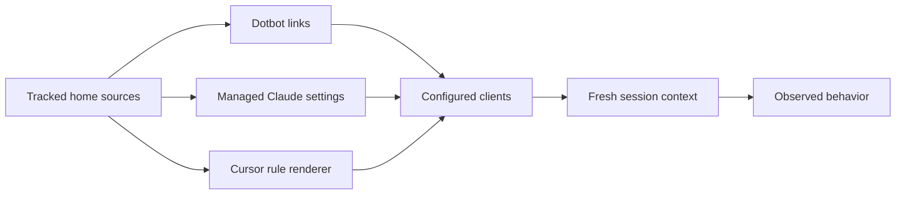

# Workstation, harness, and shared memory

**Purpose:** Understand how a request becomes verified work without loading every instruction or
historical record.
Read [the glossary](/GLOSSARY.md) before changing these boundaries or terms.

## Follow the work

**Context:** The current request, applicable instructions, relevant knowledge, and fresh tool
results inform the next decision.
Stored information becomes useful only when selected for the task and checked against current
evidence.

**Authority:** Documents and historical agreements provide context; they do not authorize unrelated
actions or publication.
The lead checks worker results and retains decisions, shared processes, and Git delivery.

## Know the layers

| Layer | Owner | Boundary |
| --- | --- | --- |
| Global behavior | [Shared instructions](/home/.agents/AGENTS.md) | Golden rules, authority, privacy, and task routing |
| Procedures and responsibilities | [Skills](/docs/agent-skills.md) and [roles](/docs/agent-instructions.md#shared-role-agents) | Loaded for the task, not copied into startup |
| Client mechanics | [Coding-agent configuration](/docs/ai-harness/README.md) | Native models, tools, credentials, and runtime state |
| Product knowledge | Each repository's overview, glossary, docs, and decisions | Technical facts remain with their product |
| Shared personal memory | The Obsidian life vault | Profiles, shared goals, repository navigation, and coordination |

**One owner:** Dotfiles documents configuration and reusable procedures, not every project's
architecture or private evidence.
The family knowledge repository explains concepts; product repositories own implemented behavior and
local decisions.
The vault connects people and projects without duplicating authoritative technical detail.

## Trace configuration to execution

**Delivery:** Pi and Claude global instructions link to the shared source; Cursor receives a
rendered regular file.
Skills and references have individual links; credentials and runtime state remain client-native.
Read [file ownership](/docs/ai-harness/README.md#file-ownership) before changing delivery paths.

**Evidence:** Source, installation, loading, authentication, and exercised behavior are separate
states.
A passing link test does not prove the next agent follows the instruction.
Read [verification](/docs/ai-harness/harness-verification.md) before defining or claiming
acceptance.

## Understand shared memory

**Repositories:** Current guides describe applicable behavior; plans distinguish accepted work,
proposals, and unresolved questions.
Consequential superseded decisions retain status and successor links outside ordinary task
navigation.
Code comments explain non-obvious intent and constraints; they change with the behavior they
describe.

**Vault:** `~/life/` is shared Markdown knowledge synchronized through Obsidian Sync, not a Git
repository.
Its overview routes to goals, people, repositories, and coordination; profiles remain person-owned.
Read its local `AGENTS.md` and collaboration guide before editing; use Sync history for recovery.
No company evidence or credentials belong there.

**Retention:** Keep useful facts with provenance and scope; give temporary exceptions a recheck or
end condition.
Remove obsolete operational instructions within scope; preserve rationale when it still explains the
present.
Read [memory lifecycle](/home/.agents/references/memory.md) before retaining or retiring an
agreement.

## Evolve through feedback

1. Identify concrete friction, a changed constraint, or a new requirement.
2. Find the current owner; verify the source before adding a new rule, skill, role, or service.
3. Make the smallest coherent change while preserving authority, privacy, and domain boundaries.
4. Check actual delivery and behavior; record evidence limits and a recovery path.
5. Update current guidance, retire stale instructions, and keep useful history outside default
  reads.

**Checks:** Formatting, link resolution, delivery tests, and focused behavioral cases protect
different properties.
Measure whether the next decision improves; do not optimize only for fewer files or more stored
memory.
Avoid empty architecture scaffolding, duplicate policy, and speculative abstractions.

**Decisions:** ADRs need explicit authority and all three gates: costly reversal, surprising
context, and viable alternatives.
Routine reference facts and how-to instructions stay in ordinary documentation.
Read [the ADR gate](/home/.agents/references/memory.md#gate-architectural-decisions) before creating
a record.

## Navigate by question

- Read [setup](/docs/setup.md) before installing or applying machine-specific overrides.
- Read [tooling](/docs/tooling.md) before syncing packages or changing hooks.
- Read [instruction ownership](/docs/agent-instructions.md) before changing what loads into a
  session.
- Read [model and role selection](/home/.agents/references/delegation.md) before delegating across
  configured clients.
- Read [documentation maintenance](/docs/documentation.md) before restructuring guidance or retiring
  stale material.
- Read [the workspace index](/docs/workspace.md) before consulting task-specific plans or historical
  verification.
